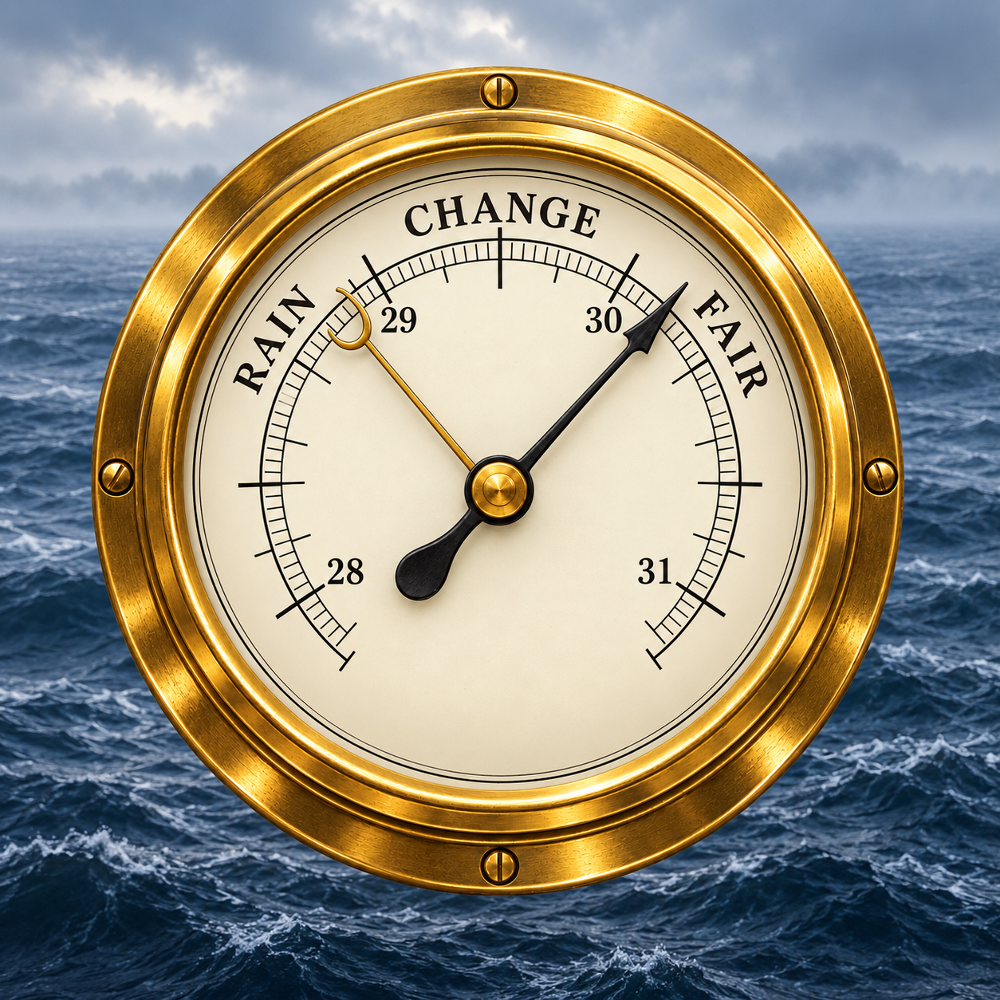

# Ship’s Barometer 0.3.0

An offline Signal K weather instrument with a responsive pressure chart. No QuestDB,
InfluxDB, internet connection, API key or extra history plugin is required.

Open **Ship’s Barometer** from Signal K’s Webapps after enabling the plugin. The
webapp shows current sensor pressure in hPa, a measured three-hour change, the
existing tendency and plain-language pressure forecast. Select 6, 12, 24 or 48 hours.
Day, Night and Red use the same controls and Auto rules as Endurance: the theme
button cycles the manual modes, and Auto follows vessel `environment.mode`.
Day selects Day; Night selects Red while `navigation.state` is sailing or motoring,
and Night while anchored or moored. Missing day/night state falls back to Night.
Your manual selection is stored in your browser.

If your Signal K weather provider supplies fresh pressure forecasts with an issue
time, you can also compare the weatherman’s prediction with what the boat actually
measured. Turn on **Show Weather API forecast comparison** in plugin settings.
The boat remains the authority; this optional comparison never changes its analysis.

## Optional weather comparison

No weather account, API key or new service is added. This uses only the default
provider already available through Signal K’s Weather API. It is **off by default**.

- Boat observations stay in front. A solid forecast underlay shows predictions saved
  before their forecast time arrived; a dotted line shows the latest available future
  forecast, up to 24 hours ahead. A Now divider separates past and future.
- Historical comparison starts collecting when enabled. It never invents earlier
  predictions or replaces them with revised forecasts or later observations.
- Hover over forecast points for valid, issued and received times and the provider
  label, where supplied. Otherwise the label identifies Signal K’s default provider.
- Fresh forecasts must have been issued within six hours. A fresh vessel position
  (within five minutes) is required, and comparison points must be within 20 km of
  that position. Forecasts are checked every 15 minutes.
- If the provider or connection is unavailable, or issue timing cannot be verified,
  future forecasts are omitted. Previously saved historical comparisons can remain.
  The boat’s own instrument continues working offline.
- Forecast pressure may use a different reference from raw sensor pressure. Values
  are displayed as supplied, without altitude correction or artificial alignment.
- Comparison storage is separate: at most 120 points per collection, covering no more
  than 72 past hours and 48 future hours, at most one supplied point per valid hour
  for each provider/location. No external database is needed. Changed data is saved
  every three minutes and at orderly shutdown.

**Provider compatibility:** the Weather API standard supplies forecast valid times
and optional pressure, but does not guarantee an issue time. This version requires
an explicit ISO `issuedAt` field on each forecast record; receiving a forecast now
is not proof it was issued recently. Providers without that metadata are safely
skipped, with an explanation in the webapp. A Weather API compliant provider alone
does not guarantee compatibility. We do not create or configure a provider for you.
See [the comparison contract](docs/forecast-comparison.md).

## History and data quality

- A separate recorder retains at most **72 hours (3 days)** and **4,320 samples**.
- At most one actual observation per 60 seconds; no timer-generated samples.
- Original Signal K timestamps are retained, including across restarts. Invalid,
  future, out-of-order and other-vessel observations are rejected. Source IDs are
  required; known external weather sources are excluded.
- The recorder locks to the first accepted pressure source. Use **History pressure
  source** to select an exact Signal K source ID when multiple sources exist. The
  chart’s source selection is independent of the legacy forecast engine.
- Lines stop at gaps longer than 90 seconds. Single observations remain visible as
  points. Missing observations are never filled. No history is imported from the
  forecast engine or an external database.
- The three-hour delta compares actual readings within one minute of the three-hour
  baseline; it is unavailable without that baseline or with stale current data.
  It describes the change between those observations, even if there are gaps between them.
- Current pressure and analysis are hidden when pressure observations are over five
  minutes old. Historical points remain available, with their actual times.
- `pressure-history.json` in the plugin data directory is atomically replaced every
  three minutes when changed, and on orderly shutdown. Expired observations are
  pruned during ingestion, reads, loading and saves. An abrupt power loss may lose
  the latest three minutes. History storage errors appear in the webapp and server log.
- The chart displays raw sensor pressure. The existing analysis retains its own
  altitude correction, sampling and source handling, so its reference can differ.

The existing pressure/tendency/forecast calculation files are unchanged. The optional
local weather assessment remains opt-in. Its existing explanatory reasons appear
when enabled and fresh. Weather API comparisons are display-only and independent
of both the onboard history recorder and the existing analysis.

## Install, update and rollback

For the local release tarball, in the Signal K installation directory (commonly
`~/.signalk`), run `npm install /absolute/path/signalk-ships-barometer-0.3.0.tgz`.
Restart Signal K, enable Ship’s Barometer in Plugin Config, then open its Webapp.
For containers, use the installation directory inside the Signal K container and
retain the persistent Signal K data volume. This is local installation guidance;
initial onboard review on TBD confirms live observations and historical collection. Forecast accuracy has not been field-calibrated.

Before updating, back up the plugin configuration and its data directory. To roll
back, reinstall `signalk-ships-barometer@0.2.0` (or your saved previous tarball) and
restart Signal K. The new history file is independent of legacy `offline.json` and
`local-assessment.json`. Keep the backup until your aboard checks pass.

## Development

Run `npm ci` then `npm test`. Tests cover retention, minute bounds, original timestamps,
source isolation, persistence/restart, corrupt storage, write failures, chart gaps,
endpoint validation and plugin lifecycle, alongside the inherited forecast tests.
Comparison tests also cover issue-time validation, stale/offline behavior, bounded
archives, restart, chart ordering and isolation from onboard analysis.
The read-only `/plugins/signalk-ships-barometer/history?hours=24` endpoint accepts
only 6, 12, 24 and 48 hours. Browser assets ship locally with the package.

---

<!-- Independent modifications by SCarns, 2026. Derived from oyve/signalk-barometer-trend v2.3.4; see NOTICE. -->
# Ship's Barometer



**Offline weather interpretation from the boat's own sensors.** Ship's Barometer combines traditional barometric forecasts with an optional assessment of measured pressure changes, wind strengthening/easing, moisture conditions and water-temperature context.

This is an independent continuation of [signalk-barometer-trend v2.3.4](https://github.com/oyve/signalk-barometer-trend/tree/v2.3.4), created by **[oyve](https://github.com/oyve)**. The underlying [barometer-trend](https://github.com/oyve/barometer-trend) library is also by oyve. Their work supplies the original pressure analysis and forecast models; this project adds integration corrections, local observations, quality checks and independent packaging. It is maintained by [SCarns](https://github.com/SCarns) and is not endorsed by the original author.

## What it does

- Converts Signal K true-wind direction from radians to the degrees required by the forecasting library, including a one-time conversion of legacy saved history.
- Retains all 21 pressure/forecast paths used by the original 2.3.4 plugin and existing dashboards.
- Optionally publishes `environment.outside.weather.assessment`: measured changes, short reasons, SI units, source IDs, original timestamps, missing inputs and quality flags.
- Uses local humidity/temperature or a supplied Derived Data dew point, with checks for disagreement and observation-time mismatch.
- Compares air and dew point with local water temperature while explicitly distinguishing transducer-depth water from a measured surface temperature.
- Preserves separate pressure and assessment history across restarts. Runs without any weather API or internet connection after installation.

The assessment is **descriptive and experimental**. It does not provide a calibrated rain probability, future wind speed, confirmed fog, gust forecast or new automatic alarm. Heat index and wind chill remain with Derived Data. The optional assessment is off by default.

## Install

Available on [npm](https://www.npmjs.com/package/signalk-ships-barometer). Refresh the Signal K store and search for **Ship's Barometer**, or install from your Signal K user directory:

```sh
cd ~/.signalk
npm install --save signalk-ships-barometer
```

Download `signalk-ships-barometer-0.3.0.tgz` from [GitHub Releases](https://github.com/SCarns/signalk-ships-barometer/releases/latest) and copy it into your Signal K user directory, normally `~/.signalk`:

```sh
cd ~/.signalk
npm install --save ./signalk-ships-barometer-0.3.0.tgz
```

**Disable Barometer Trend before enabling Ship's Barometer.** The plugins share the original forecast output paths; running both would create competing publishers. You can keep the old package installed for rollback.

Restart Signal K and enable **Ship's Barometer** in plugin settings. To use the extra assessment, enable **Local weather assessment**. Check [installation and migration](docs/installation.md) for source/depth settings and history handling.

Releases are published on npm under **scarns**, with the Signal K discovery keyword and app icon metadata. Store indexing/cache refresh may take time. See [publishing to the Signal K store](docs/publishing.md) for future releases.

## Local inputs and output

| Input | Signal K path | Units |
|---|---|---|
| Pressure | `environment.outside.pressure` | Pa |
| Air temperature | `environment.outside.temperature` | K |
| True wind direction | `environment.wind.directionTrue` | rad |
| True wind speed | `environment.wind.speedTrue` | m/s |
| Humidity | `environment.outside.humidity` or `environment.outside.relativeHumidity` | ratio |
| Optional supplied dew point | `environment.outside.dewPointTemperature` | K |
| Optional water temperature | `environment.water.temperature` | K |

Set the assessment source IDs explicitly when multiple local sources share a path. Blank source fields retain the first valid local source. Sources identified as Open-Meteo, NOAA or WeatherAPI are excluded from the assessment. Only this vessel's timestamped observations are accepted. The source IDs and timestamps used remain visible in the assessment.

The new assessment contains `pressureState`, `windState`, `moistureState`, `waterContext`, `fogContext`, `qualityFlags`, `measurements`, `units`, `inputs`, `missing` and `reasons`. `windOutlook` is explicitly `uncalibrated`.

## Evidence and development

The first release comes from a local archive study and installation testing. The wind-angle fix corrects a unit-contract error; it does **not** establish improved rain accuracy. The pressure-to-future-wind association was inconsistent across periods and decision-window timings, so the new assessment reports observed changes rather than an automatic wind warning. Water context has software tests, but no boat-fog accuracy score.

The release is based on the working **2.3.4** lineage. Upstream's newer main branch uses a different library interface and path layout; this project intentionally retains the installed 2.3.4 output contract. See [validation and limits](docs/validation.md).

Requires Node.js 18 or newer. For development:

```sh
npm ci
npm test
```

Runtime dependencies are bundled in the release tarball; development dependencies are not. Contributions should include meaningful tests and retain the distinction between measured conditions, hypotheses and verified forecast outcomes.

## License and credits

[Apache License 2.0](LICENSE). Original license text is retained; modified-file attribution and additions are recorded in [NOTICE](NOTICE) and [CHANGELOG.md](CHANGELOG.md). Runtime dependencies retain their own license notices. The nautical artwork was generated with OpenAI image generation at SCarns' direction.
